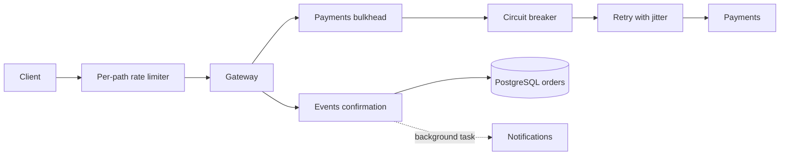

# Lab 11 — Advanced Microservice Patterns

Experiments ran locally on `k3d-quickticket` on 2026-10-16. Evidence uses UTC. There was no push, registry publication or production deployment. ArgoCD auto-sync stayed disabled, as in the previous labs.

## Goal and data path

Add best-effort notifications without making checkout depend on delivery, and bound payment failures/concurrency in the gateway. Events remains the owner of reservations/orders; payments is the existing mock processor. No database schema or other service's domain contract was changed.



The initial database had six events and 4,480 orders. Checkout probes used the existing high-capacity **event 6**, not original inventory in events 3/5. Probes ran inside a gateway pod against Service DNS, with keep-alive disabled to avoid pinning all Service calls to one TCP endpoint. There was no gateway port-forward load test. Background mixedload was deliberately not added: these are isolated, counted fault-injection series, not another capacity test.

## Implementation and deployment

- `app/notifications/` follows the payments service shape: typed `POST /notify`, health with fault settings, request Counter/Histogram and `notifications_notify_total{result}`. It has its own Dockerfile on port 8083 and the same dependency pins as payments.
- `k8s/notifications.yaml` declares one replica, ClusterIP port 8083, process health probes, resources and the locally imported `quickticket-notifications:v1` image with `imagePullPolicy: Never`.
- Gateway implements three total retry attempts by default (not an initial call plus three extra retries), exponential backoff with jitter, error classification and counters. Unknown exceptions and other 4xx are not retried. Cancellation propagates.
- Circuit state is per process; HALF_OPEN permits one recovery probe. The limiter keeps independent one-second sliding windows per normalized endpoint. Bulkhead keeps a semaphore permit across the complete CB/retry operation and releases it in `finally`, including cancellation.
- `/pay` schedules notification only after confirmed order creation. Notification HTTP errors are logged but never change the user response. Gateway health still gates only on events/payments.
- Compose includes notifications and its URL. Kubernetes gateway uses `quickticket-gateway:lab11-v1`, `Never`, notifications URL and all seven retry/CB/rate/bulkhead tunables with defaults from the task.

Build/import commands actually used:

```bash
docker build -t quickticket-gateway:lab11-v1 ./app/gateway
docker build -t quickticket-notifications:v1 ./app/notifications
k3d image import -c quickticket quickticket-notifications:v1 quickticket-gateway:lab11-v1
kubectl apply -f k8s/notifications.yaml -f k8s/gateway.yaml
kubectl patch rollout gateway --subresource=status --type=merge -p '{"status":{"promoteFull":true}}'
```

For these functional tests I explicitly promoted to all five replicas rather than repeating Lab 7's timed canary experiment. The repository keeps the existing canary strategy. Local images must be rebuilt/imported on another cluster; this lab does not extend the existing three-service GHCR workflow or claim that remote GitOps can deploy these local tags.

## Task 1 — Real fault injection

### Test 1: notifications do not block payment

```bash
kubectl set env deployment/notifications NOTIFY_FAILURE_RATE=0.3 NOTIFY_LATENCY_MS=300
kubectl rollout status deployment/notifications --timeout=60s
kubectl exec -i gateway-5c7c5fbb66-4vvcr -- python - burst 30 < loadgen/lab11-probe.py
```

**Result: ok=30, fail=0.** Maximum client-observed `/pay` duration in this series was **93.158ms**. In-cluster Prometheus returned `/reserve/{id}/pay` p99 **0.0986788s**, below 100ms, despite 300ms notification latency. Destination metrics showed:

```text
notifications_notify_total{result="success"} 18
notifications_notify_total{result="failed"} 12
```

Actual failure rate was **12/30 = 40%**, not exactly the configured 30% probability. The independent healthy recovery series later returned 30/30 with maximum `/pay` 97.510ms. These observations rule out a mandatory 300ms notification wait; they do not establish a long-term latency distribution. Source: `lab11-notify.json`, `lab11-recovery.json`.

### Test 2: retry under transient payment failure

Payments used `PAYMENT_FAILURE_RATE=0.3`, with rollout completion awaited before each changed setting. All three 30-request series are retained, including the unfavourable early samples:

| Series | Successful checkout | Exhausted payment retries | Evidence |
|---|---:|---:|---|
| First | 27 | 3 | `lab11-retry.json` |
| Repeat | 27 | 3 | `lab11-retry-repeat.json` |
| Third, after the recovery experiment | 30 | 0 | `lab11-retry-third.json` |

The first series' Prometheus snapshot already showed `retried=12`, `succeeded_after_retry=5`, `exhausted=3` for target payments. The third snapshot showed cumulative `retried=83`, `succeeded_after_retry=18`, `exhausted=31`; those totals also include the intervening **100%-failure CB test**, not just the third series. Scrapes are every five seconds, so an immediate snapshot can lag the final request. Raw response bodies distinguish `Payment failed` from confirmation failures.

The third series satisfies the requested 30/30 demonstration. Across all three series, **84/90** succeeded; none of the failed runs was discarded. `0.3³ = 2.7%` is a probability under independent failures, not a deterministic bound of one failure per 30. No payment retry was added around order confirmation or notification.

### Design answers

**Why non-blocking notifications?** Order success must not depend on optional message delivery. `create_task` schedules work without awaiting its latency; destination counters and gateway warnings make failure visible. This is best-effort delivery: process death can lose tasks, so durable delivery would need an outbox/queue and idempotent consumers.

**Why CB outside retry?** The breaker sees one logical operation's final result, not three transient attempt failures. Once OPEN it skips the retry loop. Reversing the nesting changes the failure-count unit and can trip the breaker within a single operation. In this implementation `CircuitOpenError` is non-retryable, so it would not literally be retried forever even in the reverse composition; the key distinction is semantics, not an inevitable infinite retry.

**Payment safety limitation:** the mock `/charge` has no idempotency-key storage. Retrying after an ambiguous timeout could duplicate a real charge. This lab demonstrates the required algorithm against a mock; it is not production-safe money movement. The configured HTTP timeout is per attempt, not an overall deadline: three 5s attempts plus backoff can exceed 15s.

## Task 2 — Circuit breaker and rate limiter

### Circuit OPEN and recovery

With `PAYMENT_FAILURE_RATE=1.0`, the in-cluster 80-checkout series returned **25 × 500** after exhausted retries and **55 × 503** with a circuit-open explanation. Prometheus showed **five OPEN transitions**, one per gateway process. This is the expected five outer failures per pod, not five individual downstream attempts cluster-wide.

After restoring `PAYMENT_FAILURE_RATE=0.0`, waiting through the 30-second cooldown and completing the payments rollout, the next series returned **30 × 200**. Prometheus showed **5 OPEN, 5 HALF_OPEN, 5 CLOSED** transitions. Sources: `lab11-circuit-open.json`, `lab11-recovery.json`.

### Rate limiting

For an unambiguous per-process test, the probe targeted one Ready gateway pod IP while all five replicas remained deployed. It sent 100 concurrent reads at the default limit 10:

```text
200=10 429=90
HTTP 429
Retry-After: 1
```

Thirty sequential reads with a 200ms pause all returned 200 with **zero 429**. Prometheus recorded non-zero `gateway_rate_limit_rejections_total{path="/events"}`. Sources: `lab11-rate.json`, `lab11-steady.json`. The lab's approximate 50/50 split applies to balanced traffic across five processes, not to one pinned pod; sequential requests can also take longer than one limiter window. This limiter is per endpoint/process, not per user and not a shared cluster quota.

## Bonus — Bulkhead isolation

The protected deployment kept all five replicas. A temporary baseline Deployment ran the same image with **only the `/pay` bulkhead wrapper removed**, outside the gateway Service selector. Its temporary image was `quickticket-gateway:lab11-baseline`. Both test paths used the same real events/payments services and the same 200m gateway CPU limit. Payments injected **3000ms latency and zero configured failures**.

For both variants, the test pinned one gateway process and temporarily used `RATE_LIMIT_RPS=100`. Otherwise 30 simultaneous `/pay` requests would be rejected by the 10-RPS limiter before they could exercise a ten-slot bulkhead. Thirty reservations were prepared sequentially directly through events first, avoiding the known nested reservation-pool bottleneck. Then **30 `/pay` requests ran concurrently**, alongside 30 reads from a separate coroutine/client flow. These setup changes are explicit; this is not a claim that 30 balanced requests bind five independent ten-slot bulkheads.

### Original 200m events configuration, separate client pod

| Variant | Payment outcomes | Read outcomes | Reads >500ms | Read maximum |
|---|---|---|---:|---:|
| No bulkhead | 9 × 200; 21 × 500 after payment/failed confirmation | 29 × 200; 1 × 504 | 2 | 5004.650ms |
| Bulkhead MAX=10 | 10 × 200; 20 × 503, bulkhead full | 30 × 200 | 1 | 1856.865ms |

The cap improved the outcome but did **not** make every read fast in the original CPU-constrained setup. The baseline errors were confirmation failures after successful mock charges, not injected payment failures. Authoritative separate-client results are in `lab11-bulkhead-baseline-isolated.json` and `lab11-bulkhead-protected-isolated.json`.

Earlier `lab11-bulkhead-baseline.json` / `lab11-bulkhead-protected.json` and their `-500m.json` retests used a client process inside a measured gateway pod. That process shared the server CPU quota, so those preliminary latency comparisons are **not authoritative**. All are retained, not silently replaced. The independent client was then created as a temporary `lab11-probe` pod using the gateway image with a sleep command, outside the gateway Service selector.

Both direct 50ms metric polling and Prometheus `max_over_time(gateway_bulkhead_in_flight{target="payments"}[2m])` observed **10** on the protected pod. Each 30-request protected trial produced **20** bulkhead rejections. Client-observed durations also include network/event-loop scheduling; the semaphore acquisition timeout is 500ms, not a guaranteed 500ms end-to-end response deadline. The probe aligns the short occupancy interval with an upcoming five-second Prometheus scrape so the peak is observable; it does not alter the gauge value.

### Controlled retest

To separate the Lab 10 bottleneck from gateway admission control, events CPU was temporarily raised from 200m to **1000m for both variants**, with the same ten-slot database pool and no source change. Gateway remained limited to 200m; the client was in its separate pod. An initial attempt immediately after replacing events failed during reservation setup with a connection error/timeout; no load-result table was produced for that invalid attempt. After confirming events `/health` was healthy, the same tests completed:

| Variant | Payment outcomes | Read outcomes | EVENTS ok<=500ms / slow | Read p99 (nearest rank, 30 samples) |
|---|---|---|---|---:|
| No bulkhead | 25 × 200; 5 × 500 on confirmation | 30 × 200 | ok=29 slow=1 | 1102.135ms |
| MAX=10 | 10 × 200; 20 × 503, bulkhead full | 30 × 200 | **ok=30 slow=0** | **349.622ms** |

Sources: `lab11-bulkhead-baseline-isolated-1000m.json`, `lab11-bulkhead-protected-isolated-1000m.json`; settings: `lab11-fixture.txt`. The protected result satisfies the isolation timing check **under this explicitly stated fixture**, not under the original 200m events cap. No result of `ok=0 slow=30` is claimed for the baseline. The final rejection counter was 80 cumulatively across protected trials; direct polling and Prometheus both proved the cap of ten. The normal 200m manifest and 10-RPS gateway setting are restored after experiments.

### Design answers

**Why bulkhead outside CB?** One permit covers the whole logical operation, including retries/backoff. A local bulkhead rejection occurs before entering the breaker, so local queue pressure is not counted as a payment-service failure. An OPEN breaker briefly acquires/releases a slot in this nesting. `CB(bulkhead(retry(call)))` would still bound concurrency, but would count local bulkhead timeouts against the downstream breaker; it does not automatically mean each retry gets a separate slot. Only placing the bulkhead inside the retry loop has that latter problem.

**Bulkhead versus rate limiter?** The limiter bounds request starts per endpoint/time window; the bulkhead bounds simultaneous work held by one dependency, including slow requests and retries. Both are local to each process here; neither is inherently cluster-wide. Slow async HTTP alone does not inevitably block the event loop: [HTTPX async support](https://www.python-httpx.org/async/) allows other tasks to progress. The actual unprotected test also exposed events confirmation/pool/CPU pressure, so its entire slowdown cannot be attributed to gateway event-loop starvation. The semaphore timeout uses the standard [asyncio synchronization contract](https://docs.python.org/3.11/library/asyncio-sync.html).

## Validation and cleanup

Nine executable unit tests in `loadgen/lab11-tests.py` cover retry classes/backoff/exhaustion/cancellation, breaker OPEN/recovery/single HALF_OPEN probe, limiter expiry/key isolation, and bulkhead timeout/exception/cancellation release. Actual output: `lab11-unit-tests.txt`. Docker builds/imports, Compose configuration and server-side Kubernetes dry-runs passed.

Temporary baseline Deployment and independent probe pod were removed. Redis test holds were flushed after all probes stopped. Payments and notifications both have zero failure/latency injection; events is back to 200m CPU; gateway is back to 10 RPS and MAX=10. Gateway is Healthy with 5/5 available; all four application services and PostgreSQL/Redis are Ready. Final separate-client smoke test returned 3/3 successful checkouts, and health reported events/payments/notifications OK with the payment circuit CLOSED. Evidence: `lab11-final-smoke.json`, `lab11-final-state.txt`.

The data PVC remains Bound, schema revision is `0002_events_email`, and all six events remain. Orders increased from **4,480 to 4,749**; no order or database volume was deleted. The delta is not simply the number of HTTP-200 responses: a read-only check found **20 orders confirmed despite gateway 500s** (9 IDs from the first baseline and 11 from the separate-client 200m baseline). A gateway timeout does not cancel the downstream transaction. Evidence: `lab11-late-confirmations.txt`. This reinforces the need for payment/confirmation idempotency and reconciliation rather than treating a client error as proof of no side effect.

Moodle submission is a separate final step. Temporary image tags remain in the local image cache for reproduction; no test workload remains running.

## Checklist

- [x] Task 1 — notifications, manifests, fire-and-forget, retries, observed destination failures and design answers.
- [x] Task 2 — circuit OPEN/CLOSED, per-process rate limiting, Retry-After and metric evidence.
- [x] Bonus — bounded concurrency, before/after comparison, cap/rejection metrics and design answers; all-fast reads demonstrated with explicitly documented 1000m events test headroom, not claimed at 200m.

## Implementation excerpts

The following are the actual implementations tested, rather than pseudocode.

### Retry, circuit breaker, limiter and bulkhead

```python
async def call_with_retry(func, target: str, max_retries: int = RETRY_MAX):
    """Make at most max_retries attempts, retrying only transient failures."""
    if max_retries < 1:
        raise ValueError("max_retries must be positive")
    base_delay = RETRY_BASE_DELAY_MS / 1000
    for attempt in range(max_retries):
        try:
            result = await func()
        except Exception as exc:
            retryable = isinstance(exc, (httpx.TimeoutException, httpx.ConnectError))
            if isinstance(exc, httpx.HTTPStatusError):
                status = exc.response.status_code
                retryable = 500 <= status < 600 or status in (408, 429)
            if not retryable:
                RETRY_TOTAL.labels(target, "non_retryable").inc()
                raise
            if attempt == max_retries - 1:
                RETRY_TOTAL.labels(target, "exhausted").inc()
                raise
            RETRY_TOTAL.labels(target, "retried").inc()
            await asyncio.sleep(base_delay * 2 ** attempt + random.uniform(0, base_delay))
        else:
            if attempt:
                RETRY_TOTAL.labels(target, "succeeded_after_retry").inc()
            return result


class CircuitOpenError(Exception):
    """Raised by CircuitBreaker.call when the circuit is open (fast-fail)."""


class CircuitBreaker:
    """Per-process breaker with one recovery probe at a time."""

    OPEN = "OPEN"
    CLOSED = "CLOSED"
    HALF_OPEN = "HALF_OPEN"

    def __init__(self, threshold: int, cooldown_s: float, name: str = "cb"):
        self.threshold = threshold
        self.cooldown = cooldown_s
        self.name = name
        self.failures = 0
        self.state = self.CLOSED
        self.opened_at = 0.0

    def _transition(self, new_state: str):
        """Record a state change. Use this from your .call implementation
        so transitions show up in Prometheus."""
        if self.state != new_state:
            log.warning(f"circuit[{self.name}] {self.state} -> {new_state}")
            CB_STATE_TRANSITIONS.labels(new_state).inc()
        self.state = new_state

    async def call(self, func):
        if self.state == self.OPEN:
            if time.time() - self.opened_at < self.cooldown:
                raise CircuitOpenError(f"circuit[{self.name}] OPEN")
            self._transition(self.HALF_OPEN)
        elif self.state == self.HALF_OPEN:
            raise CircuitOpenError(f"circuit[{self.name}] recovery probe in progress")
        try:
            result = await func()
        except asyncio.CancelledError:
            if self.state == self.HALF_OPEN:
                self.opened_at = time.time()
                self._transition(self.OPEN)
            raise
        except Exception:
            self.failures += 1
            self.opened_at = time.time()
            if self.state == self.HALF_OPEN or self.failures >= self.threshold:
                self._transition(self.OPEN)
            raise
        else:
            self.failures = 0
            self._transition(self.CLOSED)
            return result


class RateLimiter:
    """Per-endpoint, per-process one-second sliding window."""

    def __init__(self, rps: int):
        self.rps = rps
        self.window_s = 1.0
        self.hits: dict[str, deque] = defaultdict(deque)

    def allow(self, key: str) -> bool:
        now = time.time()
        q = self.hits[key]
        while q and q[0] < now - self.window_s:
            q.popleft()
        if len(q) >= self.rps:
            return False
        q.append(now)
        return True


class BulkheadFullError(Exception):
    """The downstream concurrency budget could not be acquired in time."""


class Bulkhead:
    def __init__(self, name: str, max_concurrent: int, acquire_timeout_s: float):
        if max_concurrent < 1 or acquire_timeout_s <= 0:
            raise ValueError("bulkhead capacity and timeout must be positive")
        self.name = name
        self.semaphore = asyncio.Semaphore(max_concurrent)
        self.acquire_timeout_s = acquire_timeout_s

    async def call(self, func):
        try:
            await asyncio.wait_for(self.semaphore.acquire(), self.acquire_timeout_s)
        except asyncio.TimeoutError:
            BULKHEAD_REJECTIONS.labels(self.name).inc()
            raise BulkheadFullError(f"bulkhead[{self.name}] full") from None
        BULKHEAD_IN_FLIGHT.labels(self.name).inc()
        try:
            return await func()
        finally:
            BULKHEAD_IN_FLIGHT.labels(self.name).dec()
            self.semaphore.release()


payments_cb = CircuitBreaker(CB_FAILURE_THRESHOLD, CB_COOLDOWN_S, name="payments")
```

The payment wrapping line is:

```python
pay_resp = await payments_bulkhead.call(
    lambda: payments_cb.call(lambda: call_with_retry(_charge, target="payments"))
)
```

### Notifications service

```python
"""Best-effort order notifications with observable fault injection."""

import logging
import os
import random
import time

from fastapi import FastAPI, HTTPException, Request
from prometheus_client import CONTENT_TYPE_LATEST, Counter, Histogram, generate_latest
from pydantic import BaseModel
from starlette.responses import Response


NOTIFY_FAILURE_RATE = float(os.getenv("NOTIFY_FAILURE_RATE", "0.0"))
NOTIFY_LATENCY_MS = int(os.getenv("NOTIFY_LATENCY_MS", "0"))
REQUEST_COUNT = Counter("notifications_requests_total", "HTTP requests", ["method", "path", "status"])
REQUEST_DURATION = Histogram("notifications_request_duration_seconds", "HTTP duration", ["method", "path"])
NOTIFY_TOTAL = Counter("notifications_notify_total", "Notification outcomes", ["result"])

logging.basicConfig(level=logging.INFO)
log = logging.getLogger("notifications")
app = FastAPI(title="QuickTicket Notifications", version="1.0.0")


class Notification(BaseModel):
    event: str
    order_id: str


@app.middleware("http")
async def metrics_middleware(request: Request, call_next):
    start = time.monotonic()
    response = await call_next(request)
    if request.url.path != "/metrics":
        REQUEST_COUNT.labels(request.method, request.url.path, response.status_code).inc()
        REQUEST_DURATION.labels(request.method, request.url.path).observe(time.monotonic() - start)
    return response


@app.get("/health")
def health():
    return {"status": "healthy", "failure_rate": NOTIFY_FAILURE_RATE, "latency_ms": NOTIFY_LATENCY_MS}


@app.get("/metrics")
def metrics():
    return Response(content=generate_latest(), media_type=CONTENT_TYPE_LATEST)


@app.post("/notify")
def notify(body: Notification):
    if NOTIFY_LATENCY_MS > 0:
        time.sleep(NOTIFY_LATENCY_MS / 1000)
    if random.random() < NOTIFY_FAILURE_RATE:
        NOTIFY_TOTAL.labels("failed").inc()
        log.warning("Notification failed event=%s order=%s", body.event, body.order_id)
        raise HTTPException(500, "Notification delivery failed")
    NOTIFY_TOTAL.labels("success").inc()
    log.info("Notification sent event=%s order=%s", body.event, body.order_id)
    return {"status": "sent", "event": body.event, "order_id": body.order_id}
```

`app/notifications/requirements.txt`:

```text
fastapi==0.136.0
uvicorn==0.44.0
prometheus-client==0.25.0
```

### Notifications manifest

```yaml
apiVersion: apps/v1
kind: Deployment
metadata:
  name: notifications
spec:
  replicas: 1
  selector:
    matchLabels:
      app: notifications
  template:
    metadata:
      labels:
        app: notifications
    spec:
      containers:
        - name: notifications
          image: quickticket-notifications:v1
          imagePullPolicy: Never
          ports:
            - containerPort: 8083
          env:
            - name: NOTIFY_FAILURE_RATE
              value: "0.0"
            - name: NOTIFY_LATENCY_MS
              value: "0"
          readinessProbe:
            httpGet: {path: /health, port: 8083}
            periodSeconds: 5
          livenessProbe:
            httpGet: {path: /health, port: 8083}
            initialDelaySeconds: 10
            periodSeconds: 10
          resources:
            requests: {cpu: 50m, memory: 64Mi}
            limits: {cpu: 200m, memory: 256Mi}
---
apiVersion: v1
kind: Service
metadata:
  name: notifications
spec:
  selector:
    app: notifications
  ports:
    - port: 8083
      targetPort: 8083
```
