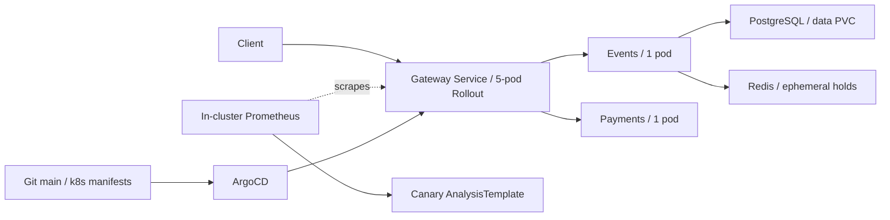

# QuickTicket SRE handbook

## Architecture



- Gateway routes reads and checkout; events owns inventory and confirmed orders.
- Redis stores temporary holds; PostgreSQL is the durable source of confirmed orders.
- Five gateway replicas do not remove the single-instance events, Redis and database risks.
- `/metrics` probes check process availability; `/health` diagnoses dependencies.

## Deploy

1. Run tests and manifest dry-runs on a feature branch. Review one independent change per PR.
2. Merge the approved change into **the fork's `main`**, the configured GitOps source.
3. GitHub Actions builds gateway/events/payments, pushes SHA-tagged GHCR images and commits the new image tags into `k8s/*.yaml`. Check all jobs, including `update-manifests`.
4. ArgoCD reads `argocd/quickticket.yaml`, applies `k8s/`, and the gateway Rollout progresses through 20/40/60/80/100%. Check the canary AnalysisRun, not just running pods.

```bash
kubectl config current-context                    # must be k3d-quickticket
kubectl get application quickticket -n argocd
kubectl get rollout gateway
kubectl get analysisrun
kubectl get pods -l app=gateway
```

**Current local exception:** auto-sync is disabled because fork-main predates the local Rollout/PVC changes. Reconcile and review main before enabling it; do not blindly sync the old manifests. Registry access uses `ghcr-secret`.

For a bad canary use `/tmp/kubectl-argo-rollouts abort gateway` if that installed plugin exists, capture the failed AnalysisRun and verify stable-only ready endpoints. Revert the bad Git change and synchronize the corrected manifest to make recovery durable. Never delete the PostgreSQL PVC as a rollback step.

## Monitoring

Open the in-cluster Prometheus UI with `kubectl port-forward -n monitoring svc/prometheus 9091:9090`; Grafana's QuickTicket Golden Signals dashboard uses this same source.

| Question | Query/check |
|---|---|
| Traffic | `sum(rate(gateway_requests_total[1m]))` |
| System errors | `(sum(rate(gateway_requests_total{status=~"5.."}[1m])) or vector(0)) / sum(rate(gateway_requests_total[1m]))` |
| Tail latency | `histogram_quantile(0.99, sum(rate(gateway_request_duration_seconds_bucket[1m])) by (le))` |
| Which path fails? | `sum by (path,status) (rate(gateway_requests_total[1m]))` |
| Pod headroom | `kubectl top pods`; compare to CPU limits |
| Canary | `kubectl get analysisrun`; inspect the latest run and `rs_hash` |

Current Prometheus scrapes gateway only. Events pool saturation, payments latency, Redis and DB health need additional targets/exporters. Lab 6 Compose alert provisioning is **not proof of active cluster paging**. Verify a test notification after configuring a cluster receiver. Treat `409` as inventory rejection, not a system `5xx`.

## Incident response

1. Record UTC time, affected paths, 5xx, latency and the latest deployment. Inspect `kubectl get pods,svc,rollouts` and recent logs from gateway/events/payments.
2. Check `/health` through an in-cluster client or a diagnostic gateway port-forward. Port-forward is fine for diagnosis, **not** capacity testing.
3. Inspect the failing dependency first. Redis loss breaks reservations; DB loss breaks reads and confirmation; payment failure breaks checkout. `connection pool exhausted` means inspect events concurrency, nested pool acquisition and idle transactions, not just gateway CPU.
4. Stop experimental load or abort a bad canary. Restore the failed dependency. After DB recovery, restart events if stale connections persist: `kubectl rollout restart deployment/events` and wait for completion.
5. Verify reads, reservation and payment/confirmation, then verify the error-rate window recovers. A Ready pod is not sufficient evidence.

Escalate to the instructor/TA after 10 minutes without a cause, immediately for all-purchase failure or continuing budget burn. Include UTC timeline, endpoint/status breakdown, logs, rollout revision and mitigation. See [the full incident runbook](../lab6.md#runbook-quickticket-high-error-rate).

## Backup and restore

For scheduled local backups apply `k8s/postgres-backup-storage.yaml` then `k8s/backup-cronjob.yaml`. The five-minute CronJob validates custom-format archives and retains five; storage on the same node is **not off-site recovery**. Verify job completion, archive age and a disposable restore regularly. These experiment resources were removed after Lab 9, so backups are not currently scheduled.

For a manual safety copy, use the demo database credentials inside the pod:

```bash
kubectl exec deployment/postgres -- pg_dump -U quickticket -d quickticket -Fc > quickticket.dump
pg_restore --list quickticket.dump
```

Before restoring: stop writers, capture a fresh safety backup if possible, identify the exact target and obtain approval for data replacement. Then restore **only the approved database**, not its volume:

```bash
kubectl exec -i deployment/postgres -- pg_restore -U quickticket -d quickticket --clean --if-exists --exit-on-error < quickticket.dump
kubectl rollout restart deployment/events
kubectl rollout status deployment/events --timeout=90s
kubectl exec deployment/postgres -- psql -U quickticket -d quickticket -c 'SELECT count(*) FROM events; SELECT count(*) FROM orders; SELECT version_num FROM alembic_version;'
```

Verify counts against the backup snapshot and run an end-to-end checkout. Record restore completion, verified recovery time and lost writes. Lab 9 measured 50.406s without PVC versus 36.835s with PVC; those are runbook measurements, not guarantees. See [backup evidence](../lab9.md).
